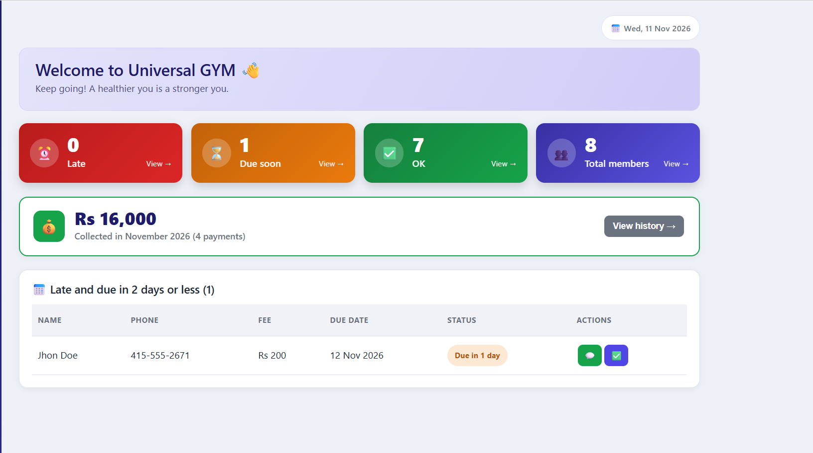
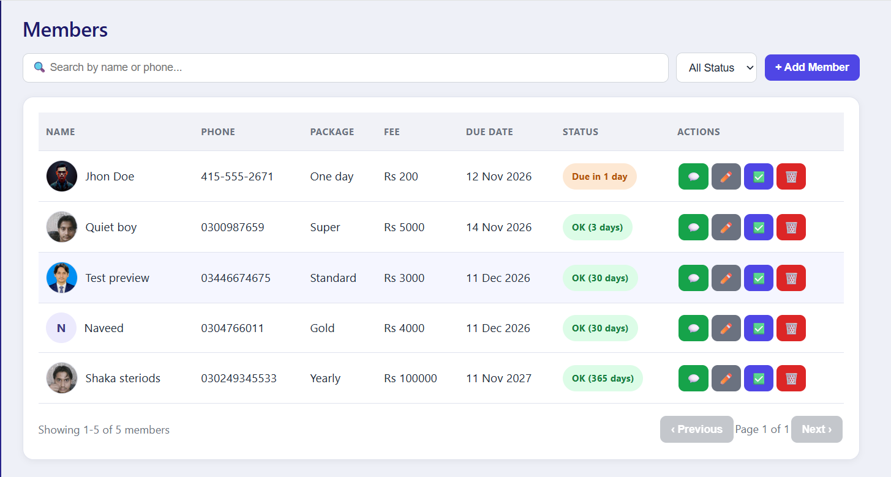
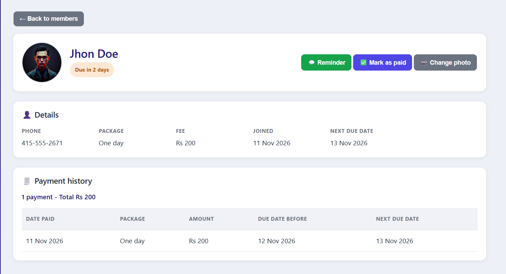
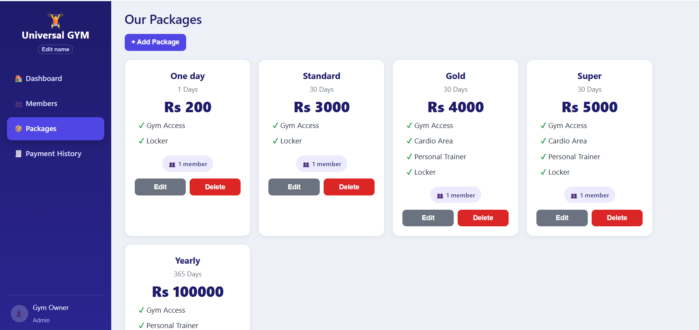
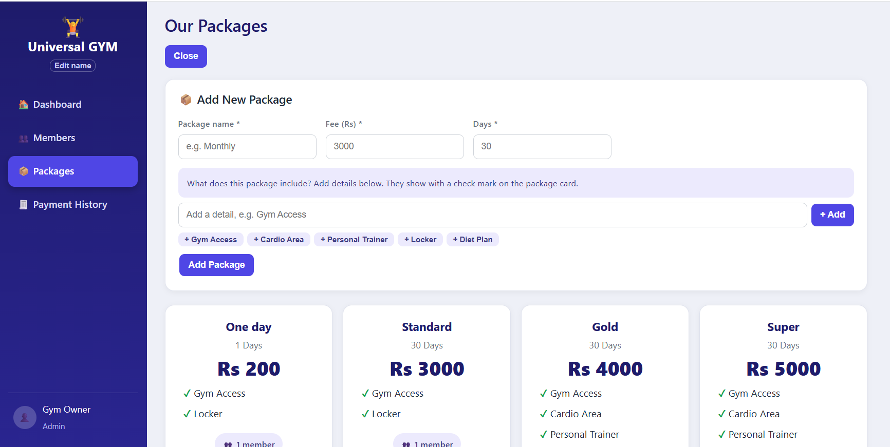
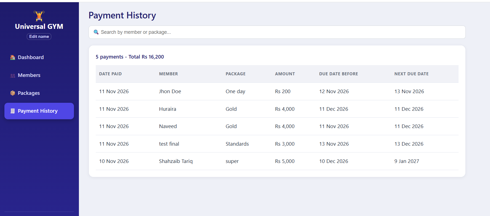
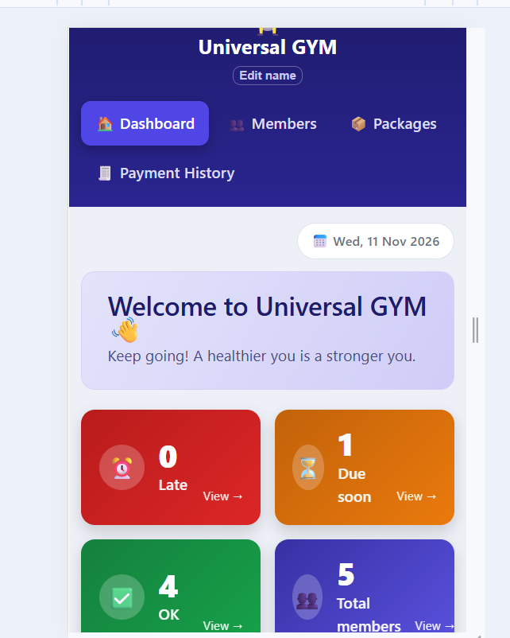
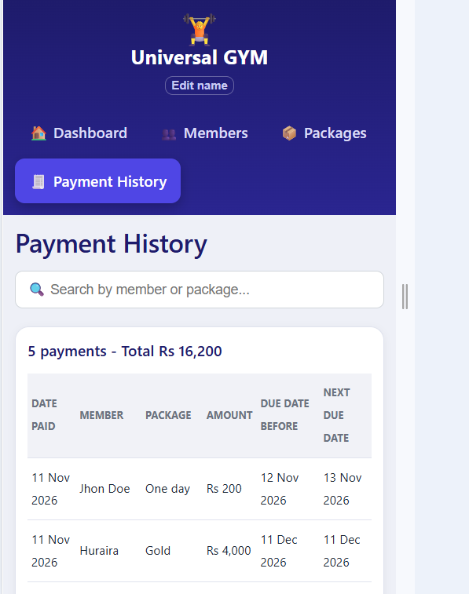

# Gym App 🏋️

A simple gym management app for small gyms that cannot afford fingerprint entry systems.

The owner adds **packages** (name, fee, days) and **members** (name, phone, photo, package). The app works out each member's next fee due date, shows who is late or due soon, records every payment, and opens **WhatsApp** with a ready reminder message.

Built with the MERN stack (MongoDB, Express, React, Node.js) as a practice project.

## Screenshot











## Features

**Dashboard**
- Four clickable cards: Late, Due soon, OK and Total members (each opens the Members page with the right filter)
- "Collected this month" card with the total and the number of payments
- List of Late and Due soon members with their round photo and quick buttons: send WhatsApp reminder and mark as paid
- Click a photo for a big popup, or click a name to open the member's details page

**Members**
- Add, edit and delete members
- Search by name or phone, filter by status, 10 members per page
- Member photo: choose a picture from the PC or take one with the live camera (saved as a small 200x200 picture)
- Change a member's package, or type a new due date by hand
- "Start new package from today" option: restarts the due date and saves a payment
- Mark as paid: moves the due date forward and saves a payment record
- WhatsApp reminder with a message that changes with the situation (late, due today, days left)

**Member details page**
- Click a member's name to open it
- Photo (click it for a big preview), status, phone, package, fee, join date and next due date
- Change or remove the photo at any time (choose from the PC or use the live camera)
- Payment history of that member with the total paid
- Send a reminder or mark as paid from the same page

**Packages**
- Package cards with name, days, fee and a check-mark list of details (for example Gym Access, Locker, Personal Trainer)
- Edit a package (renaming it also renames it on its members)
- A package cannot be deleted while members use it

**Payment History**
- All payments, newest first, with search and a running total

**Other**
- Works on phone screens (compact tables and icon buttons)
- Loading message and a clear error message when the backend is off
- Gym name can be changed from the side menu (saved in the browser)

## Fee status rule

One rule is used on every page (it lives in `frontend/src/utils.js`):

| Status | Meaning |
| --- | --- |
| Late (red) | The due date has passed |
| Due soon (orange) | 0 to 2 days left |
| OK (green) | More than 2 days left |

## Tech stack

| Part | Technology |
| --- | --- |
| Frontend | React, Vite, React Router |
| Backend | Node.js, Express |
| Database | MongoDB Atlas with Mongoose |
| Other | dotenv, cors, WhatsApp link (wa.me) |

## Project structure

```
gym-app/
  backend/
    server.js            starts Express and connects to MongoDB
    models/              Member.js, Package.js, Payment.js
    routes/              members.js, packages.js, payments.js
  frontend/
    src/
      main.jsx           starts React
      App.jsx            layout, side menu and routes
      utils.js           API address, status rule, dates, WhatsApp, photo resize
      CameraCapture.jsx  live camera photo box
      App.css            styles
      pages/             Dashboard, Members, MemberDetails, Packages, PaymentHistory
  docs/                  screenshots
```

## API

Base address: `http://localhost:5000/api`

| Method | Address | What it does |
| --- | --- | --- |
| GET | `/members` | All members, soonest due date first |
| POST | `/members` | Add a member. Send `name`, `phone`, `packageId` and optional `photo` |
| PUT | `/members/:id` | Edit name, phone, photo (an empty `photo` removes it), package (`packageId`), due date (`nextDueDate`) or start a new package today (`startToday: true`) |
| PUT | `/members/:id/pay` | Mark as paid: new due date and a payment record |
| DELETE | `/members/:id` | Delete a member |
| GET | `/packages` | All packages, cheapest first |
| POST | `/packages` | Add a package. Send `name`, `fee`, `durationDays`, `features` |
| PUT | `/packages/:id` | Edit a package (also renames it on its members) |
| DELETE | `/packages/:id` | Delete a package (refused if members use it) |
| GET | `/payments` | All payments, newest first. Use `?memberId=...` for one member |
| GET | `/payments/summary` | Total collected this month |

## How to run it

You need Node.js and a free MongoDB Atlas database.

**1. Download the project**

```
git clone https://github.com/shahzaibtariq577/gym-app.git
cd gym-app
```

**2. Backend**

```
cd backend
npm install
```

Create a file named `.env` inside the `backend` folder with your database address:

```
MONGO_URI=your_mongodb_atlas_connection_string
```

Then start it:

```
node server.js
```

You should see "Database connected" and "Server running on port 5000".

**3. Frontend** (open a second terminal)

```
cd frontend
npm install
npm run dev
```

Open http://localhost:5173 in the browser.

The backend does not reload by itself. After any change in the backend, stop it with Ctrl + C and run `node server.js` again.

## Design decisions

- **The server is the source of truth.** The screen sends only name, phone and package. The backend works out the fee and the due date, so the rules live in one safe place.
- **Validation on the server.** Name, phone, package fields and photo size are checked in the backend, because anyone can call the API without the screen.
- **A member keeps its own copy of the package name and fee.** If the owner changes a package price later, old members and old payments do not change.
- **Photos are saved as small text (200x200 JPEG).** This is simple for a small gym. For thousands of members, files in cloud storage would be better.
- **Mark as paid does not lose days.** If the member is not late yet, the new period starts from the old due date, not from today.

## Known limits and ideas for later

- No owner login yet
- Gym name is saved only in the browser
- Reminders are sent by the owner with one click (not automatic)
- Phone numbers that start with 0 are treated as Pakistan numbers (+92) for WhatsApp
- Automated tests
- Deploy online (the camera needs https)

## Author

Shahzaib Tariq, Computer Science graduate from Faisalabad.